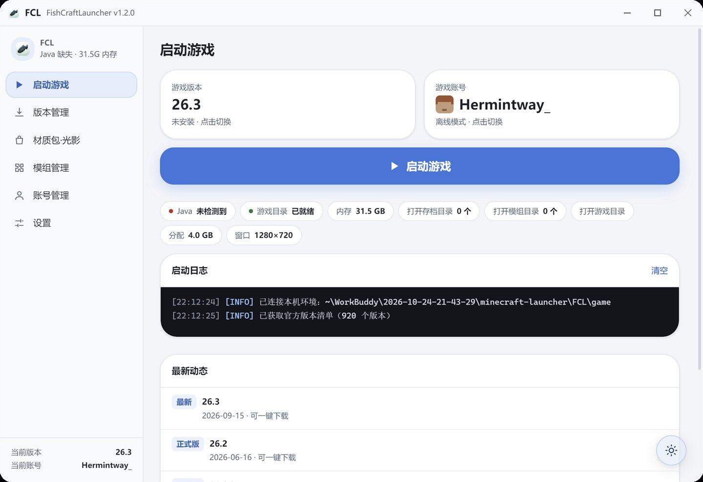
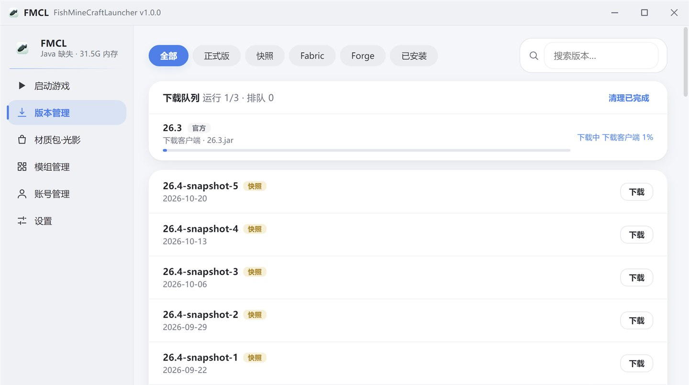
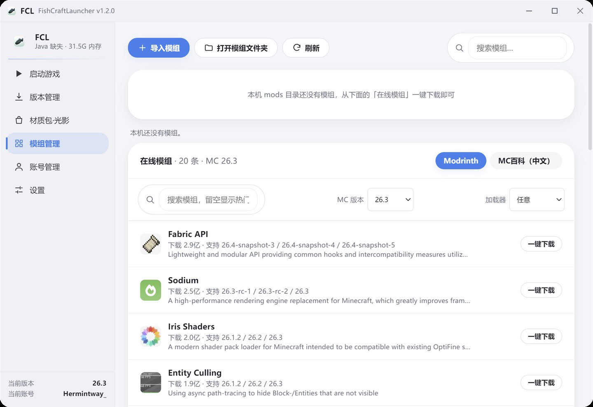
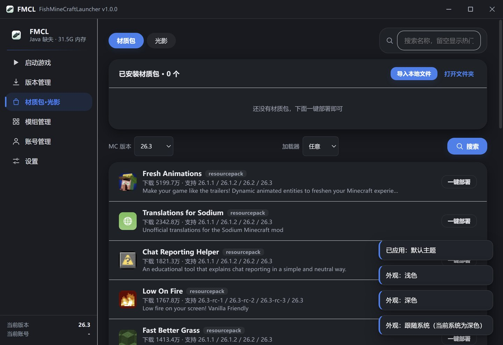
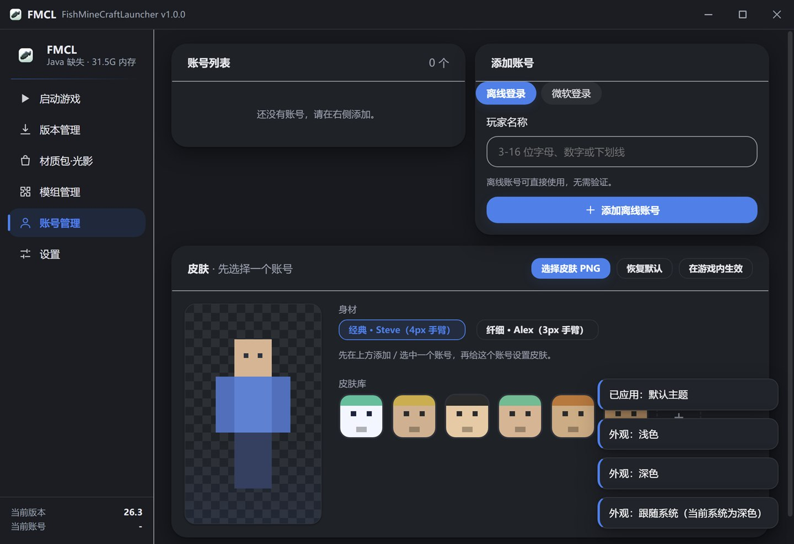
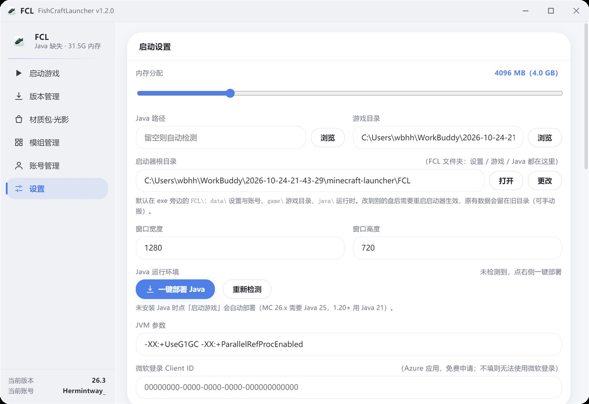
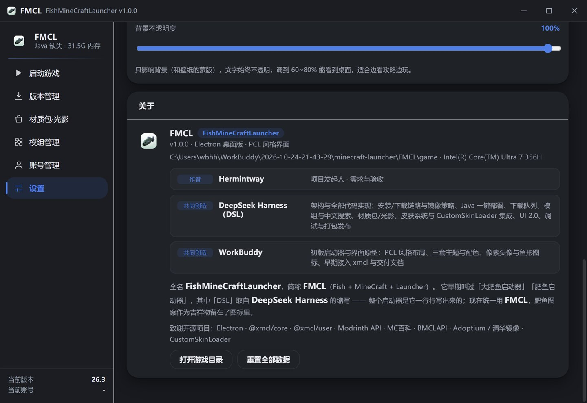

# FCL · FishCraftLauncher

> 一个绿色便携的 Minecraft 启动器：双击 exe，一切都在它旁边的 `FCL\` 文件夹里。

> **改名说明**：本仓库地址仍保留 `FMCL`（历史原因，避免旧链接和已发布的下载地址失效），
> 但项目自 **1.1.0** 起正式改名为 **FishCraftLauncher（FCL）** —— 程序名、窗口标题、数据目录都换成了 FCL。
> 从旧版升级只需要把新 exe 放到旧 exe 同一个文件夹里运行，第一次启动会自动把 `FMCL\` 迁移成 `FCL\`，账号、版本、皮肤库、Java 都在。
> 变更细节见 [Releases · v1.1.0](../../releases/tag/v1.1.0)。

**FCL**（Fish + MineCraft + Launcher，曾用名 FMCL / 肥鱼启动器）是 Windows 上的 Minecraft 桌面启动器，PCL 风格界面，Electron 构建。
集成版本与加载器安装、模组与材质包光影、离线皮肤、Java 一键部署，全程中文镜像加速，支持 3 套主题与自定义背景。

<p>
  
  
  
  
</p>



---

## 特性

### 一键启动

- 点一次「启动游戏」，自动按顺序完成：选账号 → 检查版本 → 补全依赖与资源 → 部署 Java → 启动
- 启动前**校验资源完整性**（assets / libraries 缺哪个补哪个），修掉「装到一半中断 → 进游戏闪退」
- 崩溃后自动读取 `crash-reports` 里最新的报告，把异常类写在启动日志里

### 版本与加载器

- 官方正式版 / 快照 / **Fabric / Forge / NeoForge** 一键安装
- 只在「已安装」里切换版本，不会误点到没下载的版本
- 删除版本走回收站，可反悔
- **下载队列**：最多 3 个任务并发，其余排队，进度、速度、阶段都能看到
- **远古版本与愚人节版本**：版本列表分「远古版」（old_alpha / old_beta，共 61 个）与「愚人节」（15w14a、3D Shareware、20w14infinite、24w14potato、25w14craftmine 等），并自动为老版本选择 Java 8

### 模组 / 材质包 / 光影

- **Modrinth** 在线搜索、一键下载安装（自动按当前版本 + 加载器过滤兼容文件）
- **MC百科**中文模组搜索（含热门标签），补足 Modrinth 中文生态偏弱的问题
- 本地已装模组的启用/禁用/删除；材质包与光影包支持启用、禁用、排序
- 资源管理器的 zip / jar 可以**直接拖进来导入**

### 皮肤

- **6 套内置经典皮肤**（史蒂夫·蓝 / 艾莉克斯·橙 / 绿帽连帽衫 / 红卫衣 / 黄金骑士 / 肥鱼·FCL），开箱即用
- 本地 PNG 导入（64×64 / 64×32，放大版自动缩回 64×64）、皮肤库一键切换、Steve / Alex 身材
- **内置 CustomSkinLoader**：换皮肤时自动把匹配的 CSL 构建装进 `mods\`，离线账号进游戏也能看到自己的皮肤，不需要额外下载
- 微软账号支持上传皮肤到官方服务器，服务器端立即生效

### 界面

- **3 套主题 × 3 种明暗**：DeepSeek 经典（品牌蓝）/ WorkBuddy 经典（品牌绿）/ 默认主题，浅色、深色、跟随系统
- **自定义背景图 + 磨砂玻璃**：卡片、侧栏、壁纸整体做 backdrop-filter 模糊，Windows 11 上再叠加系统级 Acrylic；背景不透明度 30%–100% 实时生效
- **托盘常驻**：点 × 最小化到托盘，托盘菜单可显示窗口或退出；可在设置里改回点 × 直接退出
- ColorOS 风格的大圆角、柔和投影、胶囊控件

> 截图使用「默认主题」；设置里可切换 DeepSeek 经典 / WorkBuddy 经典两套预设，配浅色、深色、跟随系统。

| | |
| --- | --- |
|  |  |
|  |  |

设置页（左）与关于页、背景透明度（右）：

| | |
| --- | --- |
|  |  |

### 绿色便携

运行后**不往 C 盘用户目录写任何东西**，全部收在 exe 同级的 `FCL\`：

```text
FCL\
├─ data\    设置 / 账号 / 皮肤库 / 浏览器缓存
├─ game\    游戏目录（versions / mods / resourcepacks / shaderpacks / assets / libraries / options.txt）
├─ java\    一键部署的 Java 运行时
├─ logs\    日志与崩溃转储
└─ temp\    启动器与游戏的临时文件（游戏、Forge 安装器都继承这个 TEMP）
```

- 整包拷到 U 盘或另一台电脑即可继续用，配置跟着走
- 想放别的盘：设置 → 「启动器根目录」→ 更改（写入 `FCL\config.json`，重启生效）

---

## 下载

到 [Releases](../../releases) 下载最新的 `FCL-<版本>-x64.exe`（1.1.0 起改了名字，1.0.x 的 `FMCL-*.exe` 是旧命名），双击运行即可。

- 单文件便携版，**无需安装**，首次启动会自解压到 `%TEMP%`（退出后自动清理）
- 首次启动没有 Java 也能用：点「启动游戏」会自动部署 Java 25（约 56 MB，走清华镜像）
- 未做代码签名，Windows 可能提示「已保护你的电脑」→ 更多信息 → 仍要运行

## 从源码运行

```bash
git clone <your-repo-url> FCL
cd FCL
npm install
npm start
```

要求：Windows 10/11 x64、Node.js ≥ 18。

打包成 exe：

```bash
npm run dist
# 产物：dist/FCL-1.0.0-x64.exe
```

> 打包脚本 `tools\package-win.cmd` 会把临时目录、electron 二进制、镜像都固定在项目内，避免写到系统临时目录。

## 技术栈

| 层 | 选型 |
| --- | --- |
| 桌面框架 | Electron 33（无边框窗口 + 透明背景 + contextIsolation preload） |
| 界面 | 原生 HTML / CSS / JavaScript，无前端框架 |
| Minecraft 核心 | [@xmcl/core](https://github.com/Voxelum/x-minecraft-launcher)（版本解析、启动、进程监听）、[@xmcl/user](https://github.com/Voxelum/x-minecraft-launcher)（微软 OAuth2） |
| 模组与资源 | Modrinth API、MC百科 |
| 下载 | 自研 `lib/net.js`：连接/空闲超时、重定向跟随、镜像回退、原子 `.part` 下载、SHA-1 校验 |
| 打包 | electron-builder（portable 单文件） |

国内网络默认走 **BMCLAPI / 阿里云 maven / 腾讯云 / 清华 Adoptium / 华为云 OpenJDK** 镜像，官方源仅作兜底。

## 项目结构

```text
main.js              主进程：窗口、IPC、安装器编排、下载队列、便携目录
preload.js           暴露给渲染进程的受限 API
index.html           单页结构 + SVG 图标精灵
js/app.js            渲染进程：页面状态、交互、皮肤/模组/设置等全部 UI 逻辑
js/data.js           内置静态数据（新闻兜底等）
css/style.css        设计令牌 + 组件样式 + 主题/明暗 + ColorOS 风格层
lib/installer.js     版本安装、镜像探测、资源校验
lib/java.js          Java 探测与一键部署
lib/modstore.js      Modrinth 搜索与安装
lib/cnmod.js         MC百科中文搜索（含缓存与单飞）
lib/localskin.js     CustomSkinLoader 集成（自带构建、配置修补、皮肤写入）
lib/net.js           网络与下载工具
lib/microsoft.js     微软登录（内嵌窗口 + 设备码兜底）
assets/skins/        6 套内置皮肤（64×64 PNG）
assets/csl/          内置的 CustomSkinLoader 构建 + manifest
tools/               图标生成、皮肤生成、CSL 拉取、打包脚本
```

## 配置

- **微软登录**：点「使用微软账号登录」弹出**内嵌的微软登录窗口**，登完自动回到启动器并添加账号，**不需要自己注册 Azure 应用**。设置里仍保留 Client ID 输入框，想换成自己的应用时可填（走设备码流程）。
- **内存 / JVM 参数 / 窗口尺寸**：设置页可调，默认 4 GB。

## 稳定性

- **单实例**：重复双击只会把已有窗口拉到前台，不会出现两个进程抢同一个数据目录
- **崩溃留痕**：主进程异常、渲染进程 / GPU 子进程意外退出、窗口意外关闭，全部写进 `FCL\logs\app.log`
- **下载韧性**：连接 10s / 空闲 20s 超时、镜像回退、原子 `.part` 写入、SHA-1 校验；遇到杀软占用（EPERM / EBUSY）自动退避重试
- **安装校验**：Java / 版本文件下载并解压后会校验关键文件是否存在，缺文件自动清理重试
- **日志上限**：日志面板最多保留 400 行，长时间挂机不会持续吃内存

## 常见问题

<details>
<summary>杀软 / SmartScreen 报警？</summary>

exe 未做代码签名，属于常见误报。可以下载后自行校验 SHA256，或改用源码运行。
</details>

<details>
<summary>离线账号进游戏没有皮肤？</summary>

皮肤靠 CustomSkinLoader 在客户端加载。切换到 **Fabric / Forge / NeoForge 版本**后，启动器会自动把内置的 CSL 装进 `mods\`；纯原版无法加载任何 mod，只能显示默认皮肤。首次装好后先进一次游戏，让 CSL 生成配置文件。
</details>

<details>
<summary>下载很慢 / 卡住？</summary>

启动器会先探测 BMCLAPI 与官方源的可用性再选路；如果整体网络异常，可检查系统代理是否劫持了 `*.mojang.com` 与 `bmclapi2.bangbang93.com`。
</details>

<details>
<summary>为什么只有一个 exe？卸载后残留什么？</summary>

便携版不写注册表、不装服务，删除 exe 与它旁边的 `FCL\` 即彻底卸载。
</details>

## 已知限制

- 仅 Windows x64（打包目标为 portable，未做 macOS / Linux 适配）
- 未签名，首次运行需要手动放行
- 皮肤模组依赖 CustomSkinLoader 对目标 MC 版本的兼容性，极新的快照版本可能尚未适配
- 内置的 CSL 构建截至发布时刻；遇到新版本可在 `assets/csl` 里补充构建

## 致谢

- [@xmcl/core](https://github.com/Voxelum/x-minecraft-launcher) · [@xmcl/user](https://github.com/Voxelum/x-minecraft-launcher)
- [Modrinth](https://modrinth.com) API · [MC百科](https://www.mcmod.cn)
- [BMCLAPI](https://bmclapidoc.bangbang93.com) · 阿里云 / 腾讯云 maven 镜像
- [Adoptium](https://adoptium.net) · 清华 TUNA · 华为云 OpenJDK 镜像
- [CustomSkinLoader](https://github.com/xfl03/MCLoader)（内置构建，MIT）

## 作者

| 角色 | 成员 | 负责 |
| --- | --- | --- |
| 作者 | **Hermintway** | 项目发起人 · 需求与验收 |
| 共同创造 | **DeepSeek Harness（DSH）** | 架构与代码实现：安装与下载链路、镜像策略、Java 一键部署、下载队列、模组与中文搜索、材质包与光影、皮肤系统、界面与打包发布 |
| 共同创造 | **WorkBuddy** | 初版界面原型：PCL 风格布局、三套主题配色、像素头像与鱼形图标，以及早期 xmcl 接入与交付文档 |

## License

[MIT](LICENSE)
